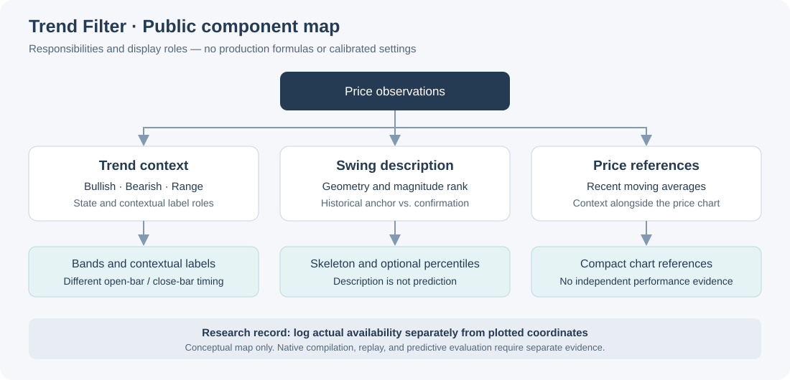

# Trend Filter Research

**Research on price-chart context, swing interpretation, and confirmation-aware evaluation.**

Trend Filter is a main-chart research project that combines trend context with statistical characterization of price-swing magnitude. It measures observed swings and compares their normalized magnitudes with historical swings in the same direction.

The selected project milestone is **Trend R3**.

## Research focus

The project concerns how to organize and communicate market context directly on a price chart. Its documentation separates three questions: what the indicator displays, whether its implementation behaves consistently, and whether any proposed use has supporting empirical evidence.

## Start here

| Material | What you can inspect | Evidence boundary |
|---|---|---|
| [Executed timing demo](results/public_timing_results.md) | Event availability, complete future windows, boundary exclusions, and a chart | Hand-authored synthetic example; no R3 signal generation |
| [Architecture](docs/architecture.md) and [visual guide](docs/visual_guide.md) | Public component roles and how to read their timing | Source-level documentation, not a full implementation audit |
| [Development story](docs/development_story.md) | Research questions, design rationale, and the R3 milestone | Documented design scope; no invented release history |
| [Current cross-market examples](#current-cross-market-examples) | Four author-supplied Trend R3 charts and interpretation notes | Qualitative observation; not a prospective validation study |
| [Evidence status](results/evidence_status.md) | Which materials are public and which validations remain unavailable | Public-demo checks are separate from R3 validation |

## Public timing demonstration

A turning-point marker can be drawn at a historical extreme after the event is confirmed. Evaluating it as if it had been known at that earlier extreme would give the analysis information it did not yet have.

The [executed notebook](notebooks/public_timing_demo.ipynb) demonstrates that distinction with constructed prices and an explicit event log. It also excludes incomplete future windows and purges development events whose targets reach the holdout. The saved [result page](results/public_timing_results.md) includes the complete ledger and interpretation.

This example audits supplied timestamps rather than detecting turning points. Its five events are teaching cases, not R3 performance observations. [Run instructions](notebooks/README.md) explain how to reproduce it; automated checks execute the notebook and compare the generated event ledger and result text.

## Development path

The project investigates how trend context and statistical descriptions of swing magnitude can be presented together on a price chart. The selected milestone is **Trend R3**.

The main-chart work addresses three questions: how to present trend context, how to distinguish developing structure from confirmed history, and how to interpret swing statistics without turning descriptive ranks into forecasts. The [development story](docs/development_story.md) explains this scope; the [project background](docs/project_background.md) describes the research scope.

## Related project

| Project | Chart role | Public record |
|---|---|---|
| **Trend Filter** | Main-chart indicator | This repository: project background, research scope, and evidence boundaries |
| **WaveFilter** | Sub-chart wave and market-state representation | [WaveFilter-Research](https://github.com/xiaoxinbuxin/WaveFilter-Research): development history, selected screenshots, and a separate synthetic evaluation demo |

The projects address different chart roles. Evidence reported for either project does not validate the other, and agreement between their displays is not independent statistical validation.

## Statistical characterization of swing magnitude

Trend Filter measures the magnitude of an observed upward or downward swing and places its normalized size within the historical distribution of same-direction swings. This provides statistical context for interpreting the current move alongside trend-state bands and contextual labels.

Measuring momentum and measuring price displacement answer different questions. The displayed swing percentile describes how large the observed move is relative to its reference sample; it does not calculate how far price will rise next or how much upside remains. Estimating future movement would require a separately defined and validated forecasting study.

## Visible components

| Component | What it displays | How to read it |
|---|---|---|
| Trend-state bands | Bullish support, bearish pressure, and a range state | Model-defined context; the open bar can still change |
| Contextual labels | Local price events classified by the current trend state | Evaluated at bar close; not instructions to enter a trade |
| Swing percentile | The current normalized swing magnitude relative to stored same-direction swings | A descriptive rank, not a reversal probability or elapsed-time percentile |
| Swing skeleton | Lines joining historical swing extremes once a segment is confirmed, plus a developing segment | Historical placement is different from the later confirmation time; the current segment can change |
| Moving-average references | A compact recent-price reference | Context for interpretation, not independent validation |

See [Visual guide](docs/visual_guide.md) for timing and interpretation details.

## System overview

The architecture separates trend context, swing description, and price references. Its arrows show conceptual responsibilities, not production calculations. Read [Architecture](docs/architecture.md) for the component relationships.

## How the project should be evaluated

The [methodology](docs/methodology.md) begins with version and feed identification, distinguishes historical anchors from actual confirmation times, and separates implementation consistency from predictive utility. Any predictive study needs a defined target, baseline, chronological evaluation boundaries, and uncertainty analysis. Trading claims would require additional execution assumptions.

The [evaluation scope](docs/evaluation_scope.md) describes those requirements; it is not a list of completed R3 tests.

## Current Cross-Market Examples

These author-supplied TradingView screenshots illustrate the selected Trend R3 milestone across four markets. They show visible chart behavior, not predictive accuracy, profitability, or statistical validity across markets. Percentages attached to labels are descriptive swing-magnitude ranks, not win rates or reversal probabilities. Historical swing anchors may be drawn only after later confirmation; static screenshots do not verify real-time availability.

The author uses follow-up chart observation to examine whether Pullback and Bounce labels remain interpretable as new price action develops, including across different markets. This is a qualitative check on behavior beyond the examples considered during development, not a claim that historical rule fitting or overfitting has been ruled out. The public record does not establish a frozen-rule, prospectively logged evaluation; selected screenshots cannot substitute for that test.

### BTCUSD · CRYPTO · 1H

Support and pressure bands alternate across a decline, recovery, and renewed selling. Pullback, Bounce, and Range Long labels appear alongside the swing skeleton, with some counter-trend labels shown more faintly.

### QQQ · NASDAQ ETF · 4H

The ETF example shows changing band states across successive advances and declines. Pullback and Bounce labels carry differing swing percentiles and visual emphasis within the same chart.

### NVDA · NASDAQ · 4H

The individual-equity example combines an uneven advance with intervening pullbacks and changing band states. Contextual labels, the swing skeleton, and recent moving-average references provide distinct layers of price-chart context.

### TVC Gold · 1H

This TVC Gold example shows pressure bands during a decline and support bands after a subsequent rise. Trend Short, Trend Long, Pullback, and Bounce labels illustrate how local events receive different names within the displayed trend context.

See [figure notes and provenance](figures/real_examples.md) for the image inventory and observation limits.

## Evidence status

The component descriptions have been checked against the author-provided Trend R3 source. This is a source-level documentation check, not a completed implementation audit. The public repository includes selected author-supplied chart screenshots, an executed synthetic event-log example, and checks for that example. It does not include a reproducible R3 evaluation, native TradingView compilation or replay evidence, or R3 performance statistics. No R3 passing-test count, prediction-accuracy claim, or trading return is asserted here.

Screenshots or numerical results from other versions, and the synthetic demonstration in WaveFilter-Research, do not establish the behavior or effectiveness of Trend R3. Any future evidence should identify its version, data, evaluation procedure, and limitations.

## Repository guide

| Directory | Contents |
|---|---|
| [docs/](docs/README.md) | Development story, architecture, interpretation, methodology, and limitations |
| [notebooks/](notebooks/README.md) | Executed public notebook and reproduction instructions |
| [demo/](demo/timing_demo.py) | Standalone synthetic event-log example |
| [results/](results/README.md) | Generated synthetic results and R3 evidence status |
| [figures/](figures/README.md) | Main-chart screenshots, conceptual architecture, and synthetic timing chart |
| [tests/](tests/test_timing_demo.py) | Regression checks for the public example |

## Scope

The production Pine Script, exact formulas, calibrated settings, private test infrastructure, raw private data, and execution-specific rules remain private. The R3 version label identifies the selected milestone; it is not a certification of correctness or predictive performance.

This repository is intended for research discussion and portfolio review. Chart appearance alone cannot establish predictive accuracy, profitability, or validity across markets.

See [Limitations](docs/limitations.md) and the [disclosure boundary](NOTICE.md) for the scope of the public material.
