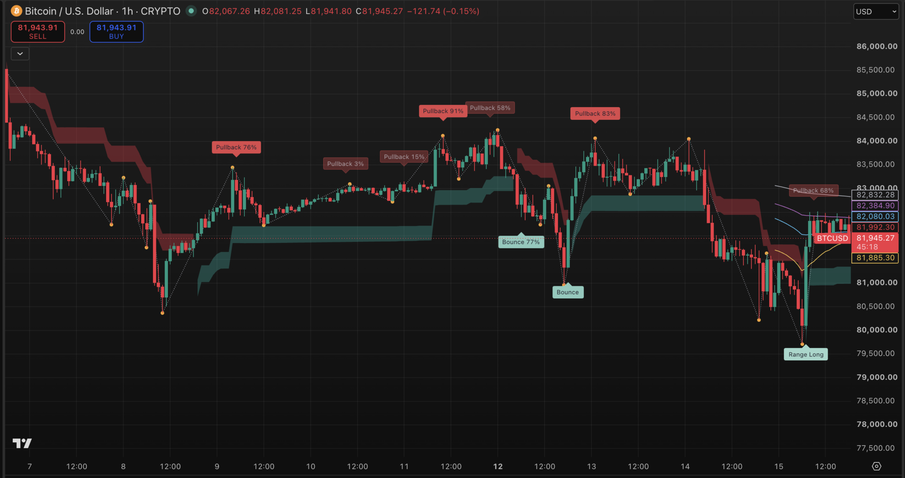
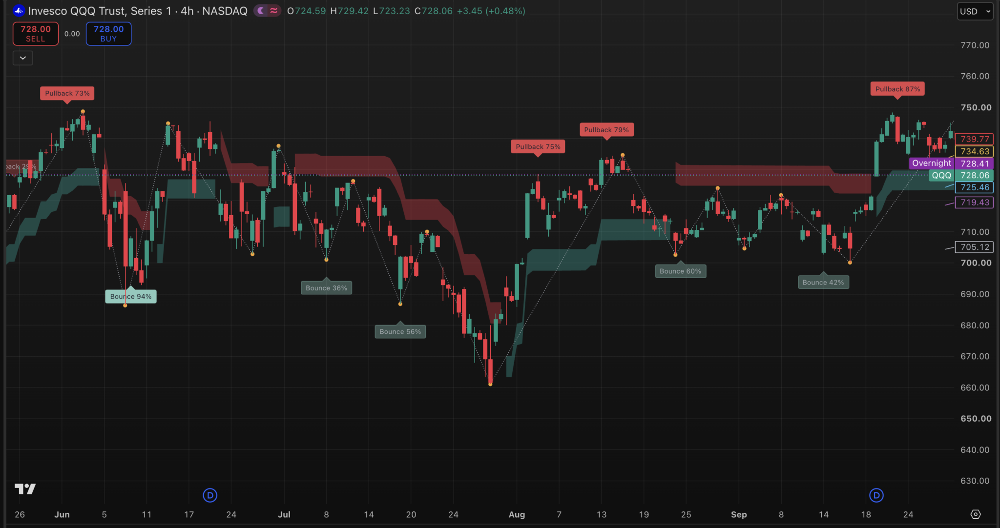
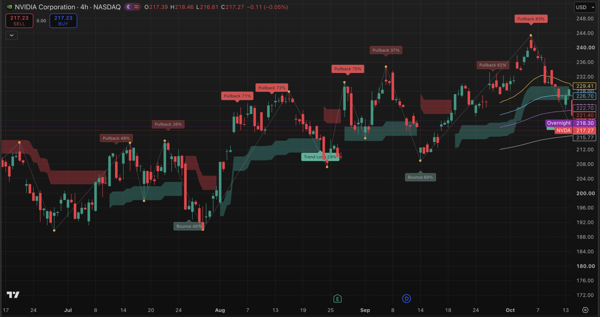
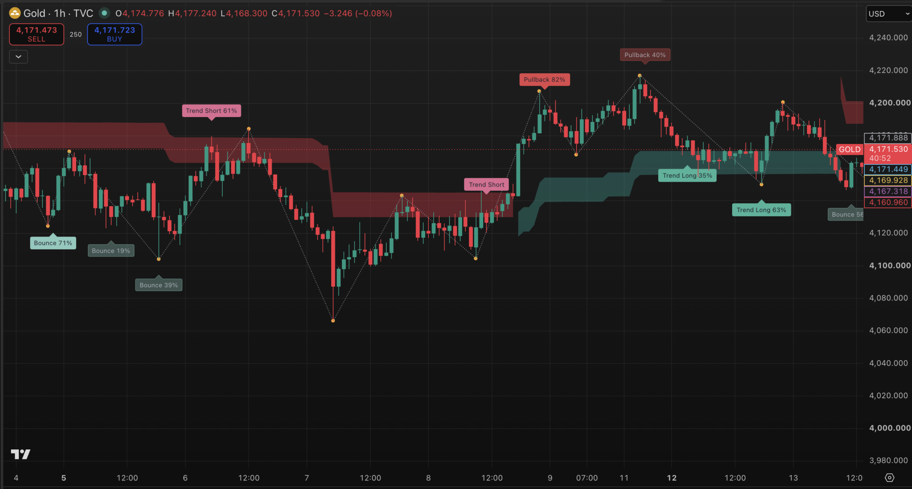

# Current Cross-Market Examples

These author-supplied TradingView screenshots illustrate the selected Trend R3 milestone across four markets. They show visible chart behavior, not predictive accuracy, profitability, or statistical validity across markets. Percentages attached to labels are descriptive swing-magnitude ranks, not win rates or reversal probabilities. Historical swing anchors may be drawn only after later confirmation; static screenshots do not verify real-time availability.

## Image provenance

The author supplied these four images for the Trend R3 portfolio. Instrument, feed, and timeframe names follow the visible TradingView headers. The files preserve the PNG attachments available in this conversation; those attachments were resized by the chat application before recovery and have not been further cropped, retouched, or annotated.

The R3 attribution comes from the author; the screenshots alone do not identify an exact source revision or settings snapshot. Capture filenames are not used to infer the chart observation period, data timezone, or a prospective test cutoff.

| Instrument | Feed / market | Timeframe | File |
|---|---|---|---|
| BTCUSD | CRYPTO | 1H | [btcusd_crypto_1h_trendr3.png](btcusd_crypto_1h_trendr3.png) |
| QQQ | NASDAQ ETF | 4H | [qqq_nasdaq_4h_trendr3.png](qqq_nasdaq_4h_trendr3.png) |
| NVDA | NASDAQ | 4H | [nvda_nasdaq_4h_trendr3.png](nvda_nasdaq_4h_trendr3.png) |
| Gold | TVC | 1H | [gold_tvc_1h_trendr3.png](gold_tvc_1h_trendr3.png) |

## Follow-up observation and overfitting

The author uses follow-up chart observation to examine whether Pullback and Bounce labels remain interpretable as new price action develops, including across different markets. This is a qualitative check on behavior beyond the examples considered during development, not a claim that historical rule fitting or overfitting has been ruled out. The public record does not establish a frozen-rule, prospectively logged evaluation; selected screenshots cannot substitute for that test.

A stronger assessment would preserve a dated rule/version snapshot, record every eligible event as it becomes available, define outcomes and baselines in advance, and assess subsequent untouched data with uncertainty estimates. It would also document any rule changes. These are evaluation requirements, not completed tests reported by this gallery.

## BTCUSD · CRYPTO · 1H

Support and pressure bands alternate across a decline, recovery, and renewed selling. Pullback, Bounce, and Range Long labels appear alongside the swing skeleton, with some counter-trend labels shown more faintly.

## QQQ · NASDAQ ETF · 4H

The ETF example shows changing band states across successive advances and declines. Pullback and Bounce labels carry differing swing percentiles and visual emphasis within the same chart.

## NVDA · NASDAQ · 4H

The individual-equity example combines an uneven advance with intervening pullbacks and changing band states. Contextual labels, the swing skeleton, and recent moving-average references provide distinct layers of price-chart context.

## TVC Gold · 1H

This TVC Gold example shows pressure bands during a decline and support bands after a subsequent rise. Trend Short, Trend Long, Pullback, and Bounce labels illustrate how local events receive different names within the displayed trend context.

## Interpretation boundaries

- Selected charts are not an exhaustive event log; selection can favor visually persuasive examples.
- A displayed percentile describes relative swing magnitude, not the likelihood of a profitable trade or reversal.
- The developing segment and open-bar state can change. Historical anchor placement is not the time a marker became available.
- TVC Gold is the instrument shown here; it is not relabeled as XAUUSD. BTCUSD is not relabeled as a perpetual futures contract.

[Evidence status](../results/evidence_status.md) · [Methodology](../docs/methodology.md) · [Visual guide](../docs/visual_guide.md)
