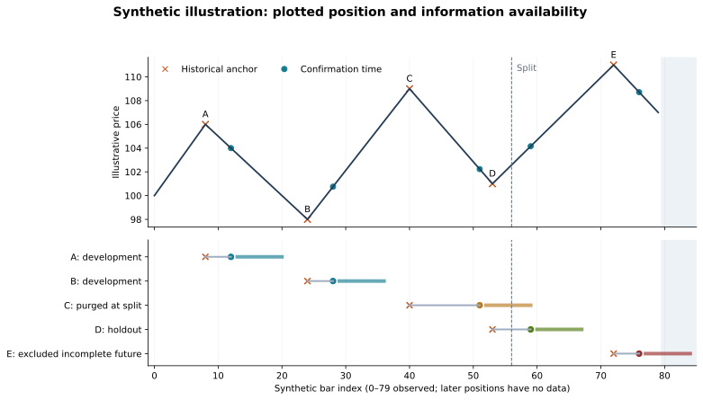

# Executed Synthetic Timing Example

Generated from [the public demo](../notebooks/public_timing_demo.ipynb). **All prices and event timestamps are hand-authored illustrations. No Trend R3 signal logic, private data, or fitted settings are used.**

## What this demonstrates

An annotation may be drawn at an earlier price extreme after confirmation. The plotted coordinate cannot be used as the time at which the event became available. This example audits a supplied event log; it does not discover or predict turning points.

There are 80 synthetic bars and 5 illustrative events. The demonstration split begins at bar 56; an evaluation window spans the next 8 bars after confirmation. These are teaching settings, not production settings or a sealed study.

| Event | Historical anchor | Confirmation | Delay (bars) | Future window | Eligibility |
|---|---:|---:|---:|---|---|
| A | 8 | 12 | 4 | 13–20 | development |
| B | 24 | 28 | 4 | 29–36 | development |
| C | 40 | 51 | 11 | 52–59 | purged_at_split |
| D | 53 | 59 | 6 | 60–67 | holdout |
| E | 72 | 76 | 4 | 77–84 | excluded_incomplete_future |

Eligible development events: **2**. Eligible holdout events: **1**. Purged at the split: **1**. Excluded for an incomplete future window: **1**.

Event C cannot stay in development because its future window reaches the holdout. Event E cannot be evaluated because part of its future window is outside the observed timeline. No return or hit-rate statistic is calculated from this deliberately small example.

## What this does not establish

The checks cover this public event-log example only. They do not verify Trend R3's event generation, prove absence of repainting, establish TradingView/Python parity, or show trading performance. Actual chart replay must record when an object appeared, not merely its final historical coordinates.

[Event ledger](synthetic_event_ledger.csv) · [Run instructions](../notebooks/README.md) · [R3 evidence status](evidence_status.md)
